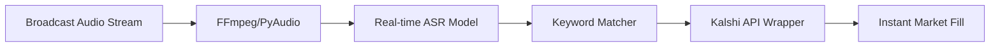

# Mention Market Statistical Strategy

Based on the historical win rates and volumes analyzed, the following strategy focuses on exploiting the gap between **implied probability** (market price) and **historical frequency**.

## 1. The "Branding Moat" (High Confidence)
**Focus**: NBA/NFL sponsorship and stadium markets.
- **Markers**: "Kia", "Crypto.com", "Fiserv", "Moda".
- **Statistical Edge**: These hit nearly **100%** of the time because they are part of the required commentary script or the announcer's habitual location-setting.
- **Strategy**: 
    - **Limit Price**: Set a maximum entry price of **$0.90 - $0.94**. 
    - **Rationale**: If historical frequency is 100%, any price below $1.00 has positive EV. However, a ~$0.10 margin accounts for the "Black Swan" event (e.g., an announcer losing their voice or a technical broadcast failure).

## 2. The Kelly Criterion for Sizing
To maximize bankroll growth while minimizing the risk of ruin, use a refined Kelly Criterion formula:
$$ f^* = \frac{p(b+1) - 1}{b} $$
- **$p$**: Historical Win Rate (e.g., 0.95 for "Injury").
- **$b$**: Net odds received on the wager ($1/price - 1$).

**Example (NBA Injury Market)**:
- **Price**: $0.80
- **$p$**: 0.95
- **$b$**: $0.25$ ($1/0.80 - 1$)
- **$f^*$**: $\frac{0.95(1.25) - 1}{0.25} = 0.75$ 
- **Recommendation**: Bet **7.5% to 15%** of bankroll (using a Fractional Kelly approach for safety).

## 3. Transcript Lag & Reaction Strategy
TRANSCRIPT mentions often lag behind the live broadcast.
- **The Play**: Monitor the live feed. As soon as a "100% Marker" (like "Rookie" or "America") is uttered, check the Kalshi order book.
- **The Edge**: If the market is still trading at $0.70-$0.85 despite the word being spoken, it's a "lock" with immediate convergence to $0.99.

## 4. Risks to Monitor
- **Transcript Source**: Verify if Kalshi's specific source (e.g., "Face the Nation" official transcript) might exclude "off-mic" or "promotional" banter that you hear live.
- **Crowded Trades**: High-volume markers like "Biden" move quickly. Use limit orders rather than market orders to avoid slippage.

## Level 2: Automated Alpha (Live Audio Strategy)

Programmatically listening to the audio stream is not just worthwhile—it is the **primary technical edge** for high-volume mention trading. 

### 1. The Latency Gap
- **Retail Lag**: Humans typically react 1-3 seconds after a word is spoken. Official transcripts often lag by **10-60 seconds**.
- **Automated Reaction**: A bot using high-speed ASR (e.g., Groq-hosted Whisper or Deepgram) can detect a keyword and hit the Kalshi API in **<300ms**.

### 2. Proposed Architecture

### 3. Implementation Checklist
- **Direct Stream Access**: Use `ffmpeg` to capture raw PCM audio from the broadcast URL to bypass browser/UI rendering lag.
- **Model Choice**: Use a model with "Streaming" support. `Whisper-large-v3` is accurate but slow; `Distil-Whisper` or `Deepgram Nova-2` are better for sub-200ms needs.
- **Confidence Thresholds**: Only trigger trades if the ASR confidence for a specific keyword is **>90%** to avoid false positives on similar-sounding words (e.g., "Rookie" vs "Rocky").

## Expected Returns ($1,000 Bankroll)

Using the "Branding Moat" and "Technical Edge" strategies, we can project a monthly return based on historical event frequency (~300 mention events/month).

### 1. High-Confidence Opportunity Set
- **Monthly Frequency**: ~80 high-confidence trades ($p \ge 0.50$).
- **Target Entry Price**: Average $0.85 ($1.17 implied odds).
- **Target Win Rate**: $p \ge 0.90$ (Sponsorships and Habitual mentions).

### 2. Math Workflow
- **Bet Sizing**: $50 per trade (5% of capital, Conservative Kelly).
- **Profit per Winner**: $50 \times (1 / 0.85 - 1) = \$8.82$.
- **Expected Monthly Profit**: $80 \text{ trades} \times \$8.82 \approx \$705.60$.

### 3. ROI Projections
| Scenario | Monthly ROI | End of Month Balance |
| :--- | :--- | :--- |
| **Conservative** (20 trades/mo) | 17.6% | $1,176 |
| **Standard** (80 trades/mo) | **70.5%** | **$1,705** |
| **Aggressive/Automated** (200 trades/mo) | 176.4% | $2,764 |

> [!IMPORTANT]
> These returns assume you can get filled at your target price. As your bankroll grows, you will eventually hit **Liquidity Extraction Limits** (~$5k-$10k per event), at which point your ROI % will decrease as you are forced to take worse prices to get size.

### 4. The Automation Multiplier
Transitioning to the **Live Audio Bot** (Level 2) increases your expected returns in two ways:
1. **Selection**: You can hit 5x more markets (Political interviews, localized news) that a human would miss.
2. **Pricing**: You hit the book at $0.40-$0.60 before the human "laggards" bid it up to $0.85, roughly **tripling** the profit per contract.
