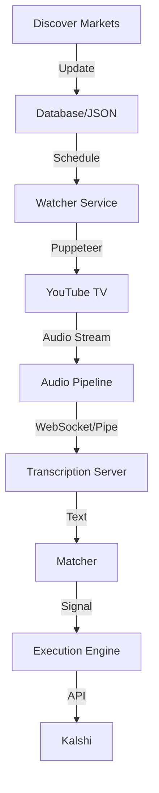

# Kalshi Automation Master Plan

## Overview
The goal is to automate the entire lifecycle of trading on "mentions" markets on Kalshi. The system will:
1.  **Discover** relevant markets and their event times.
2.  **Locate** the broadcast source (specifically YouTube TV).
3.  **Capture** real-time audio from the broadcast.
4.  **Transcribe** the audio using local AI models (Whisper).
5.  **Match** keywords from the transcript against active markets.
6.  **Execute** trades immediately upon detection.

---

## 1. Market Discovery & scheduling
**Status:** Partially Implemented (`discover_markets.js`)
**Goal:** Ensure we know *what* to watch and *when*.

*   **Refinement:**
    *   Enhance `discover_markets.js` to support "next up" scheduling.
    *   Store market start/end times precisely (already working on this).
    *   **Mapping Logic:** Create a mapping file (e.g., `channel_map.json`) that links event types or keywords to YouTube TV channels.
        *   e.g., "SOTU" -> ["CNN", "MSNBC", "FOX", "ABC"]
        *   e.g., "Super Bowl" -> ["FOX"]
        *   e.g., "Oscars" -> ["ABC"]

## 2. Broadcast Discovery (The "Watcher")
**Goal:** Tune into the right channel at the right time.

*   **Tool:** Puppeteer + YouTube TV.
*   **Workflow:**
    1.  **Login Persistence:** Use a persistent user data directory to maintain YouTube TV login session.
    2.  **Navigation:**
        *   Navigate to specific channel URLs (e.g., `tv.youtube.com/watch/<code>`).
        *   Use the search bar for specific programs if channel is unknown.
    3.  **Resilience:**
        *   Handle "Are you still watching?" popups.
        *   Monitor for stream buffering/errors.

## 3. Audio Capture Pipeline
**Goal:** Get clean audio from the browser to the transcription engine.

*   **Technology:** `puppeteer-stream`
*   **Implementation:**
    *   Launch Puppeteer with `puppeteer-stream` extensions.
    *   Get the audio stream from the active page.
    *   **Format:** Convert the stream to 16kHz Mono PCM (required by Whisper).
    *   **Transport:**
        *   *Option A (Integrated):* If running in the same process, pipe the stream directly to the Whisper buffer.
        *   *Option B (Decoupled/Preferred):* Stream the audio via WebSocket to the existing `server.js`. This allows the "Watcher" to be restarted independently of the "Brain".

## 4. Transcription Engine (The "Ear")
**Status:** Implemented (`server.js` using `@xenova/transformers`)
**Goal:** Low-latency, accurate transcription.

*   **Optimization:**
    *   Ensure the `CHUNK_THRESHOLD` in `server.js` is tuned for responsiveness vs. accuracy (currently ~2 seconds).
    *   Consider sliding windows for context (so we don't split a keyword in half).
*   **Model:**
    *   Current: `Xenova/whisper-base.en` (Good balance).
    *   Upgrade: Consider `whisper-small.en` if accuracy is low and hardware permits.

## 5. Matching & execution (The "Brain")
**Status:** Placeholder logic in `server.js`.
**Goal:** Instant execution upon keyword confirmation.

*   **Keyword Matching:**
    *   Stemming/Lemmatization: Ensure "walls" matches "wall".
    *   Phonetic Matching: (Optional) Handle misinterpretations (e.g., "hear" vs "here") if context allows.
    *   **Negative Lookahead:** (Advanced) Avoid "He did *not* say X". (Whisper usually handles punctuation well, but we need to receive it).
*   **Execution:**
    *   Using `kalshi-typescript` (wrapper exists).
    *   **Risk Management:**
        *   `MAX_POSITION`: Don't buy more than X contracts per event.
        *   `BUDGET`: Global daily loss limit.
        *   `DUPLICATE_PROTECTION`: Don't buy the same "Yes" twice within N seconds.

## 6. Architecture Diagram

## Immediate Next Implementation Steps

1.  **Modify `discover_markets.js`** to output a prioritized "Schedule" for the next 24 hours.
2.  **Create `watcher.js`**:
    *   Accepts a target Channel/URL.
    *   Launches Puppeteer (Headless=false for debugging).
    *   Joins the correct channel.
    *   Streams audio to `localhost:7654` (the existing WS server).
3.  **Update `server.js`**:
    *   Refine the WebSocket handler to expect raw PCM or a specific stream format from `puppeteer-stream`.
    *   Implement the robust matching logic.

## Configuration & Secrets
*   Need `YOUTUBE_TV_CREDENTIALS` (or pre-saved Cookies).
*   Need `KALSHI_API_KEYS` (Already in env).
*   Channel Mapping definitions.
